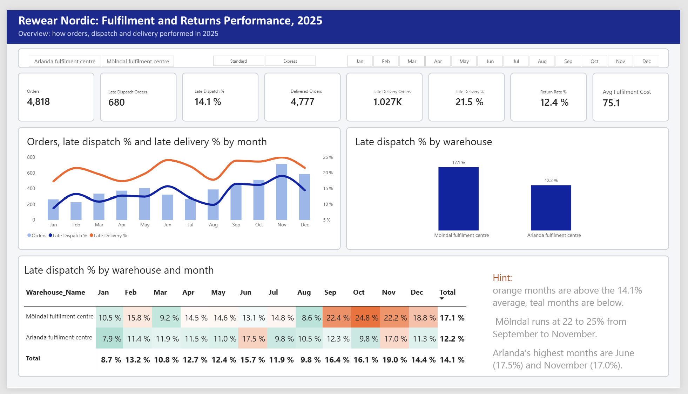
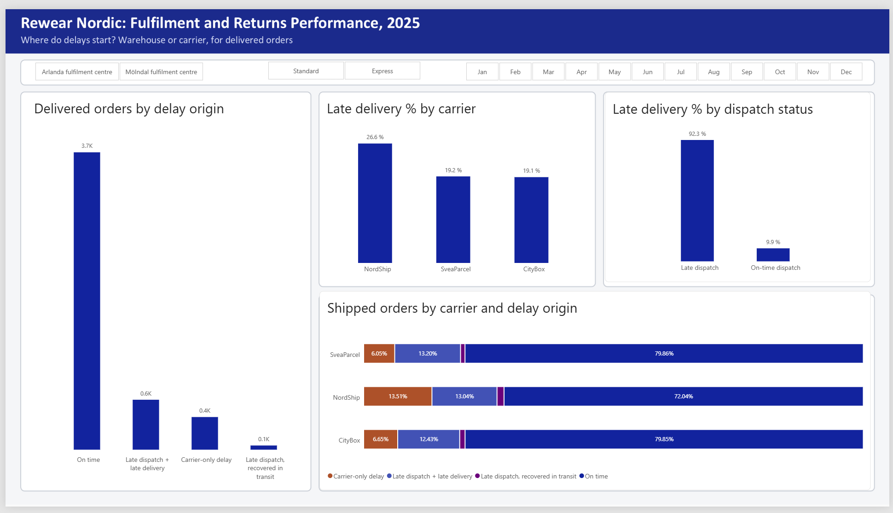
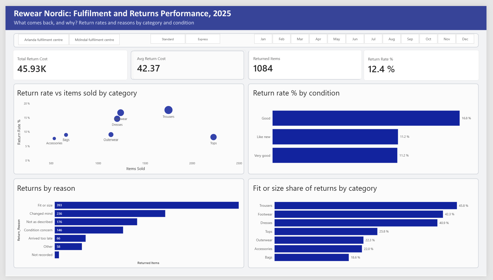
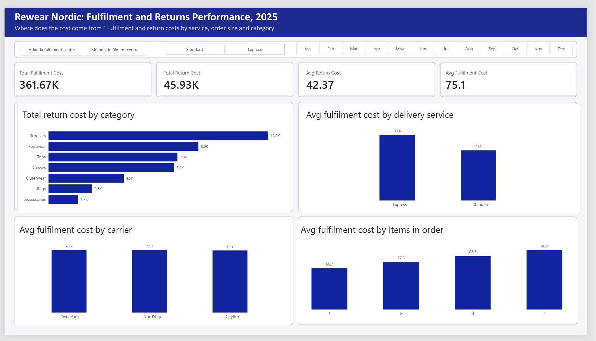

# Analysing Order Fulfilment Delays and Returns in a Swedish Second-Hand Fashion Business

Rewear Nordic is a fictional Swedish second-hand fashion retailer. Orders were growing, but dispatch was slipping, some parcels arrived late, and returns were eating into costs. This project works out where the problems start and what management should fix first. I cleaned and checked the data, analysed it in SQL, built an interactive Power BI dashboard, and wrote up recommendations with a way to measure whether each one works.

This was my first independent analytics project. Everything here is based on synthetic data, so the business is made up, but the process is the one I would follow on real data.



## The business problem

Order volumes are rising, and management is worried about three things: late dispatch, late delivery, and the cost of returns. They asked five questions.

1. How do order volumes and dispatch performance vary across months and warehouses?
2. Where do delivery delays originate, inside warehouse operations or with the carrier?
3. Which product categories and item conditions have the highest return rates, and what reasons do customers give?
4. How do fulfilment and returns costs vary across order segments?
5. Which operational improvements should management prioritise?

## The data

Synthetic order records for January to December 2025, held in one Excel workbook with seven data tables plus a ReadMe, a data dictionary and a sheet of reference rules.

| Table | Rows (raw) | Rows (clean) | What it holds |
|---|---|---|---|
| Orders | 5,000 | 4,975 | One row per order: customer, timestamp, channel, status, delivery service and fee |
| Order_Items | 9,115 | 9,115 | One row per item: price and seller entitlement (quantity is always 1) |
| Products | 9,115 | 9,115 | Category, condition, size, brand tier, list price, home warehouse |
| Fulfilment | 4,975 | 4,975 | Promised and actual pick, pack, dispatch and delivery times, carrier, costs |
| Returns | 1,084 | 1,084 | Reason, status, refund and return costs |
| Customers | 2,200 | 2,200 | Region, acquisition channel, membership |
| Warehouses | 2 | 2 | Mölndal and Arlanda, with daily order capacity (11 and 16) |

The data contains deliberate quality problems, covered in the audit below.

## Tools and why I used each one

| Tool | What I used it for |
|---|---|
| Excel | First look at the data: pivots, `LEN` vs `TRIM` checks, text-versus-number checks, date-order checks, and the audit log |
| Power Query | Repeatable cleaning of all seven tables |
| MySQL | Exploratory analysis, and an independent check of every dashboard figure |
| Power BI | Data model, DAX measures and the four-page interactive dashboard |

## How I worked, step by step

| Step | What I did | Tool |
|---|---|---|
| 1 | Read the brief, then the workbook's ReadMe, data dictionary and reference rules. Made a working copy and never touched the raw sheets | Excel |
| 2 | Created an audit log with the columns table, field, issue, how found, rows affected, decision and reason | Excel |
| 3 | Copied each table to a `Chk_` sheet and checked row counts, key uniqueness, blanks, spelling variants, data types, date order and links between tables | Excel |
| 4 | Decided what was an error and what was legitimate. For example, blank carrier and dispatch times on cancelled orders are real, not missing | Excel |
| 5 | Cleaned all seven tables with recorded steps: trimming, fixing spellings, converting text prices and dates, removing exact duplicates, flagging impossible values | Power Query |
| 6 | Checked every table after cleaning: row counts, distinct values against the reference rules, minimums and maximums | Power Query |
| 7 | Loaded the tables into Power BI and built the relationships between them, plus a date table | Power BI |
| 8 | Wrote the DAX measures (late dispatch, late delivery, return rate, costs) and checked each against a number I had worked out separately | Power BI |
| 9 | Built the four dashboard pages, one for each of the first four questions | Power BI |
| 10 | Loaded the same cleaned data into MySQL and wrote queries for each key question | MySQL |
| 11 | Compared SQL results with the dashboard. Everything matched except one return-rate figure, which I traced to three returns pointing at a placeholder item | MySQL, Power BI |
| 12 | Turned the findings into recommendations, each with a measure of success, and wrote a stakeholder summary | Docs |

## Data audit and cleaning

I logged every issue, how I found it, and what I decided. The full log is in `docs/Audit_Log.xlsx`.

| Table | Issue | Rows | Decision |
|---|---|---|---|
| Orders | Exact duplicate rows | 25 | Removed (5,000 became 4,975) |
| Orders | Timestamps stored as day-first text, e.g. `23/01/2025 19:55` | 23 | Parsed with a UK locale. The default US reading turns 1 November into 11 January, so I checked specific orders by hand |
| Orders | Trailing spaces in `Sales_Channel` | 29 | Trimmed |
| Orders | `Credit card` instead of `Card` | 19 | Standardised to `Card` |
| Orders | `Complete` and `completed` instead of `Completed` | 48 | Standardised |
| Orders | Missing `Customer_ID` | 5 | Kept, labelled `Unknown` |
| Orders | `Customer_ID` `C99999` does not exist in Customers | 8 | Kept, treated as an unknown customer |
| Products | Lower-case categories, and `Shoes` for `Footwear` | 33 and 2 | Standardised |
| Products | `Verry good`, and padded condition values | 18 and 12 | Corrected and trimmed |
| Products | `List_Price_SEK` stored as text such as `340,00 kr` | 12 | Converted to numbers |
| Order_Items | `Sale_Price_SEK` stored as text with a decimal comma | 18 | Converted to numbers |
| Order_Items | Product `P999999` does not exist in Products | 7 | Kept, shown as unknown product |
| Order_Items | Seller entitlement is 140% of price instead of 60% | 4 | Kept, flagged, not changed |
| Fulfilment | Warehouse `WH-OLD` is not a real warehouse | 5 | Replaced with the warehouse of the product ordered |
| Fulfilment | Carrier spelling variants | 25 | Standardised |
| Fulfilment | Blank carrier | 157 | All cancelled orders, labelled `Not Shipped` |
| Fulfilment | `Carrier_Cost_SEK` stored as text such as `32,08 SEK` | 14 | Converted to numbers |
| Fulfilment | Negative handling cost | 6 | Flagged, then turned positive as likely sign errors |
| Fulfilment | Delivered before dispatched | 8 | Kept, flagged, excluded from delivery-time measures |
| Fulfilment | Missing pack time, and missing delivery time on delivered orders | 14 and 10 | Left blank, not guessed |
| Returns | Lower-case return reasons | 15 | Standardised |
| Returns | Blank return reason | 9 | Labelled `Not recorded` |
| Returns | Item `OI999999` does not exist in Order_Items | 3 | Kept, shown as unknown product |
| Returns | Processed before received | 4 | Kept, flagged |
| Customers | Padded region names | 28 | Trimmed |
| Customers | Lower-case acquisition channels, and blanks | 22 and 10 | Standardised, blanks labelled `Unknown` |

Some blanks are not errors. Cancelled orders never shipped, so they have no carrier and no dispatch time, and 31 orders marked as delivery exceptions had not been delivered by the snapshot date. I left those alone.

## The dashboard

Four pages, one for each of the first four questions. I planned the layout in PowerPoint first (the wireframes are in `images/` and the page backgrounds are in `powerbi/`), then built each page in Power BI. Each page has slicers for warehouse, delivery service and month.

| Page | Question it answers | Visuals |
|---|---|---|
| Overview | 1. Volume and dispatch by month and warehouse | Eight KPI cards, a combined chart of orders, late dispatch % and late delivery % by month, late dispatch by warehouse, and a warehouse-by-month heatmap |
| Delay Origin | 2. Warehouse or carrier? | Delivered orders by delay origin, carrier delays split by origin, late delivery by carrier, late delivery by dispatch status |
| Returns | 3. What comes back, and why? | Category scatter (items sold against return rate, bubble size is return cost), return rate by condition, returns by reason, fit-or-size share by category |
| Costs | 4. Where does cost vary? | Average cost by delivery service, items in order and carrier, return cost by category |





Key measures: `Orders`, `Late Dispatch %`, `Late Delivery %`, `Return Rate %`, `Avg Fulfilment Cost`, `Total Fulfilment Cost`, `Avg Return Cost`, `Total Return Cost`. The `Delay Origin` column sorts each delivered order into on time, late dispatch plus late delivery, late dispatch recovered in transit, or carrier-only delay.

## SQL analysis

All queries are in `sql/rewear_analysis.sql`. `sql/Rewear_MySQL_Import.sql` builds the database and loads the cleaned data.

| Query | Question | Headline result |
|---|---|---|
| Q1a | Orders and late dispatch by month and warehouse | Late dispatch rises through autumn, with Mölndal at 22 to 25% from September to November |
| Q1b | Orders per day against warehouse capacity | Arlanda over capacity on 12 days, Mölndal on 14 |
| Q2a | Delay origin | 77.4% on time, 13.0% late dispatch and late delivery, 8.5% carrier-only, 1.1% recovered |
| Q2b | Late delivery by carrier | NordShip 26.6%, SveaParcel 19.2%, CityBox 19.1% |
| Q2c | Does a late dispatch cause a late delivery? | Late delivery 92.3% after a late dispatch, 9.9% after an on-time dispatch |
| Q3a | Return rate by category | Trousers 17.7%, Footwear 16.8%, Dresses 14.6%, Accessories lowest at 7.7% |
| Q3b | Return rate by condition | Good 16.8%, Very good 11.2%, Like new 11.2% |
| Q3c | Return reasons | Fit or size is 36.3% of returns |
| Q3d | Fit or size share by category | Trousers 45.8%, Footwear 42.3%, Dresses 40.9% |
| Q3e | Return reasons by condition | 24.8% of returns on Good items cite condition, against 7.6% for Very good |
| Q4a | Fulfilment cost by delivery service | Express 93.39, Standard 71.61, with the gap entirely in carrier cost |
| Q4b | Fulfilment cost by items in order | 66.72 for one item, 24.05 per item for four |
| Q4c | Return costs and refunds by category | Trousers have the highest return cost at 13,001 SEK |

I reproduced every dashboard figure in SQL as a second check. They matched, with one difference worth explaining. The Power BI return rate card shows 12.4% because it counts all 1,084 returns. The SQL figure is 12.3% because three returns point at a placeholder item that cannot be joined back to an order.

## Findings

| # | Finding | Evidence |
|---|---|---|
| 1 | Volume climbs sharply in autumn | Dispatched orders run at about 230 to 400 a month until August, then 444 (September), 509 (October), 711 (November) and 584 (December) |
| 2 | 14.1% of dispatched orders left late | 680 of 4,818. January is best at 8.7% and November worst at 19.0% |
| 3 | Mölndal dispatches late more often than Arlanda | 17.1% against 12.2%. From September to November Mölndal ran at 22 to 25% |
| 4 | Capacity does not fully explain it | Few days are over capacity, and Mölndal is late about 17% even on days within capacity, against about 11.5% for Arlanda |
| 5 | 21.5% of delivered orders arrived late | 1,027 of 4,777 |
| 6 | Most late deliveries start in the warehouse | 621 of 1,027 (about 60%) were also dispatched late. 406 were carrier-only delays |
| 7 | A late dispatch almost always means a late delivery | 92.3% of late-dispatched orders arrive late, against 9.9% of on-time dispatches |
| 8 | NordShip is the weakest carrier | 26.6% late, against 19.2% and 19.1%. All three cost about 75 SEK per order |
| 9 | About 12% of items sold are returned | 12.3% on completed orders |
| 10 | Trousers, Footwear and Dresses come back most | 17.7%, 16.8% and 14.6%, against 7.7% to 9.1% for the rest |
| 11 | Fit or size is the biggest return reason | 393 returns, 36.3%. In Trousers, Footwear and Dresses it is 41 to 46% of returns |
| 12 | Items in Good condition are returned more | 16.8% against 11.2% |
| 13 | Good items are often returned over condition | 24.8% of their returns, against 7.6% for Very good |
| 14 | Express costs more, and only because of the carrier | 93.39 against 71.61 per order. Handling and packaging are the same |
| 15 | Bigger orders cost much less per item | 66.72 for a one-item order, 24.05 per item at four items |
| 16 | The average return costs about the same everywhere | 42.37 per return. Trousers lead on total cost (13,001 SEK) because they have the most returns |
| 17 | Outerwear returns are rare but expensive | 103 returns, about 58,100 SEK refunded, around 564 SEK each |
| 18 | The recorded cost picture | About 361,700 SEK fulfilment, 45,900 SEK return costs, 309,055 SEK refunded |
| 19 | Delivered orders are fewer than dispatched orders | 4,777 against 4,818, because 31 are delivery exceptions and 10 have no delivery time recorded |

## Recommendations

**1. Find out why Mölndal dispatches late, and add support there from September to December.** Mölndal is late 17.1% of the time against 12.2% at Arlanda, and a late dispatch leads to a late delivery 92% of the time. Measure it with monthly late dispatch % by warehouse, aiming to close the gap with Arlanda.

**2. Cut fit and size returns in Trousers, Footwear and Dresses.** Add measurements and size guidance to listings, and trial it on one category first. Fit or size is 41 to 46% of returns in these categories, and together they are about 64% of return costs. Measure the return rate and the fit-or-size share before and after.

**3. Review NordShip's service levels and consider moving volume.** NordShip is late 26.6% of the time against about 19% for the other two, at the same cost per order. Measure monthly late delivery % by carrier.

Also worth testing later: tighter condition grading and descriptions for Good items, and incentives for bigger baskets, since cost per item drops sharply as orders get bigger.

## Limits

The data is synthetic and covers one year, so it cannot prove that the autumn rise is seasonal. Return reasons are what customers reported, not verified causes. There is no staffing or downtime data, so the dispatch findings are patterns and not proven causes. Costs are recorded variable costs, not profit.

## What I would do differently

I would save the Power BI file in the first five minutes and keep saving it. I lost an unsaved file once and rebuilt it from my documented Power Query code, which only worked because every cleaning decision was written down. I would also switch Power Query profiling to the whole dataset straight away, because the default only looks at the first 1,000 rows. And I would always parse text dates with an explicit locale, because a wrong guess produces valid-looking dates that are silently wrong.

## Repository

```
rewear-nordic-fulfilment-returns/
  README.md
  data/        Raw_Dataset.xlsx
  docs/        Stakeholder_Summary.pdf, Audit_Log.xlsx
  powerquery/  Rewear_Rebuild_Code.md
  sql/         Rewear_MySQL_Import.sql, rewear_analysis.sql
  powerbi/     Rewear_Nordic.pbix, Rewear_Dashboard_Backgrounds.pptx
  images/      wireframes and dashboard screenshots
```

To reproduce it, run `Rewear_MySQL_Import.sql` in MySQL Workbench, then `rewear_analysis.sql`. For Power BI, follow `Rewear_Rebuild_Code.md` to recreate the cleaning queries, relationships and measures.
